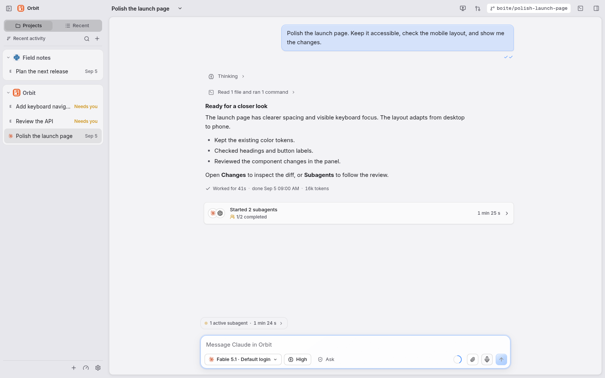
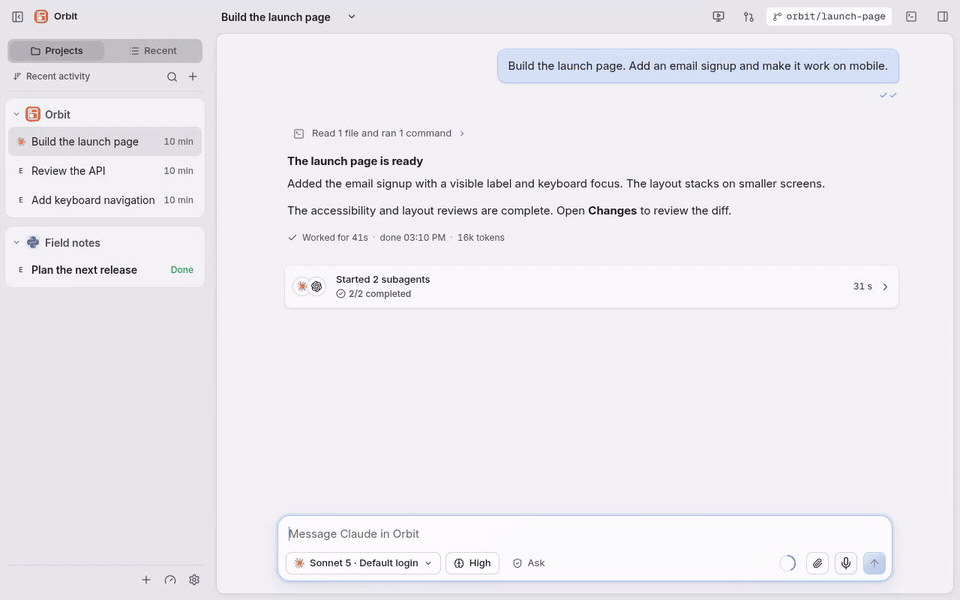

<p align="center">
  
</p>
<h1 align="center">boite <sub>[bwat]</sub></h1>
<p align="center">
  <a href="https://github.com/mtsu-dev/boite/releases">Download page</a> ·
  <a href="docs/README.md">Documentation</a> ·
  <a href="docs/server.md">Self-host</a>
</p>

<a href="https://mtsu.dev"></a>

boite is a desktop app and self-hosted server for coding agents. Run Claude Code,
Codex or [another supported agent](docs/providers.md) with your existing accounts.
Keep your projects, conversations and agents together, across your computers and phone.

<picture>
  <source media="(prefers-color-scheme: dark)" srcset="docs/media/boite-dark.png" />
  
</picture>

[Watch the walkthrough](docs/media/boite.mp4)

<details>
<summary>Animated preview</summary>



</details>

## Features

- Choose a provider, model and account for each conversation.
- Read streamed responses and tool calls beside files, diffs, previews and an agent's browser.
- Isolate tasks in Git worktrees, delegate to subagents and run workflows.
- Follow the same work from your desktop, a paired phone or the Android app.
- Connect machines and headless servers; each runs agents beside its own projects.
- Enable experimental bots for ongoing work, scheduled routines and project monitoring.

## Get started

Boite is open source and in beta. The [download page](https://github.com/mtsu-dev/boite/releases)
lists builds for Windows, macOS and Linux, including Apple Silicon and Linux ARM64.
New release notes put the download links under each platform, above the changelog.

> [!WARNING]
> Current downloads are nightly prereleases. Nightly builds are unstable and may contain
> bugs or unfinished changes. Back up your Boite data before installing or switching channels.

1. Open the [download page](https://github.com/mtsu-dev/boite/releases) and choose your system and processor.
2. Install and sign in to your agents, then connect them in Settings, Providers.
3. Open a project, choose a model and start a conversation.

See [installation and platform notes](docs/portability.md), [phone pairing](docs/phone.md)
or [the Android app](docs/android.md). To run agents on another machine, use the
[self-hosting guide](docs/server.md) or [Android server setup](docs/android-server.md).
[Desktop updates](docs/updates.md) explains channels and installing updates.

## Documentation

The [documentation index](docs/README.md) groups guides by task. Start with
[accounts and agent setup](docs/accounts.md), [projects and machines](docs/machines.md)
or [bots](docs/bots.md). [Architecture](docs/architecture.md) and
[development](docs/development.md) cover the implementation.

## Development

The app uses a Bun core, Svelte 5 and a Tauri 2 desktop shell.
Install the Bun version in `package.json`, then explore the UI with sample data:

```sh
bun install --frozen-lockfile
bun run dev:ui
```

Open the local URL with `?fake=1` to try it without agent calls.
[Contributing](CONTRIBUTING.md) covers checks;
[development](docs/development.md) covers the real core and desktop builds.

## Thanks

Thanks to [T3 Code](https://github.com/pingdotgg/t3code) for the inspiration behind
boite. We definitely took stuff from there, shoutout to them!

This project also follows
[Boite Legacy](https://github.com/beboite/boite-legacy), the earlier terminal-based app.

## License

[MIT](LICENSE). Copyright © 2026 boite contributors.
